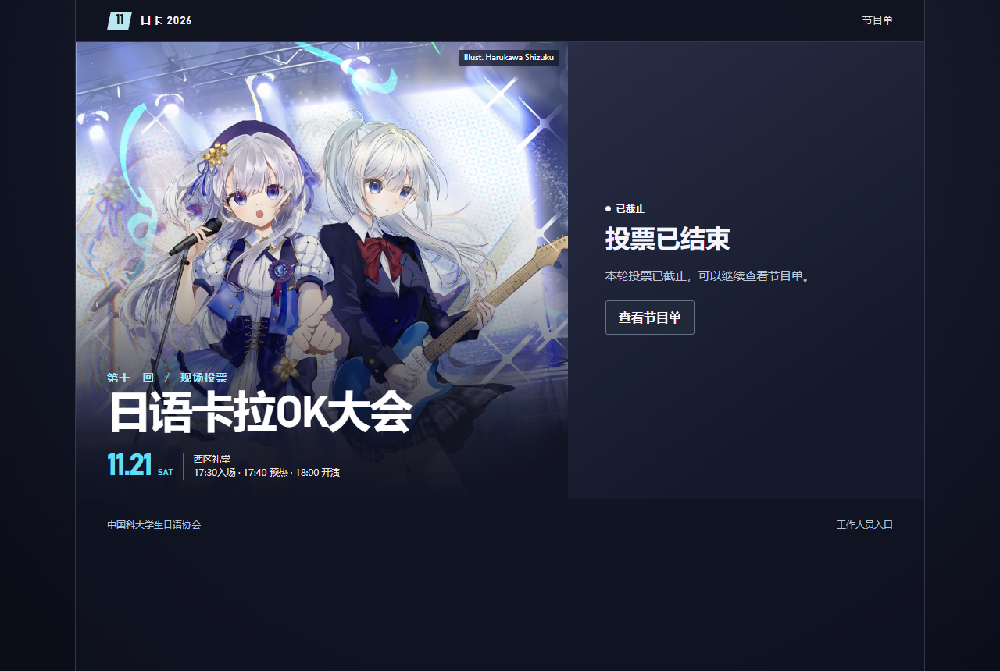
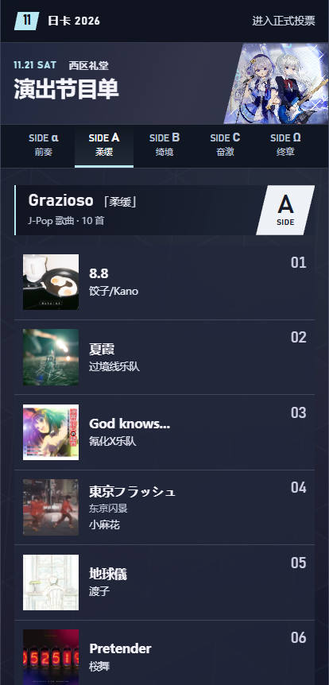
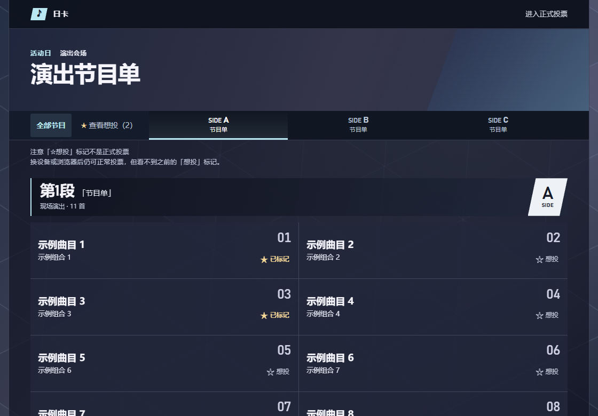
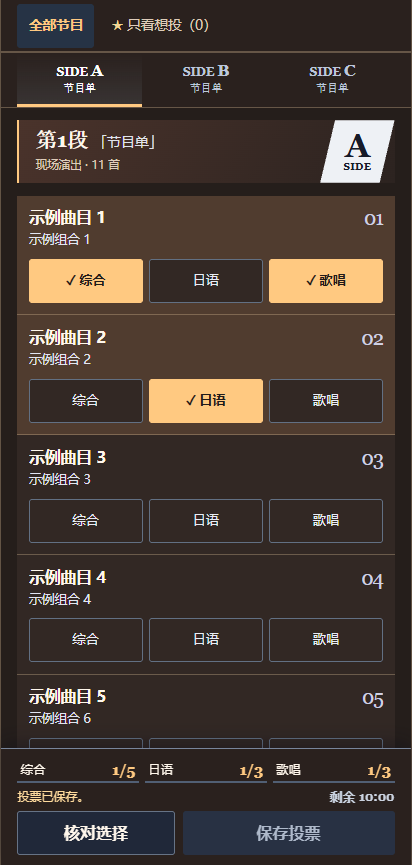

# 卡拉OK大会节目单与现场投票

本项目由日语协会往届 `ustcjlc-karaoke-2025` 工程和第十一回日语卡拉OK大会现场版整理而来，可用于新活动。Vue 提供节目单、想投清单和投票页，Cloudflare Worker 通过 Hyperdrive 连接 PostgreSQL。附带虚构节目单。观众编号只校验格式，投票窗口内以同一编号最后一次保存的选择计票。工作人员使用独立账号登录。

## 界面预览

### 第十一回日语卡拉OK大会

2026 年 11 月 21 日活动使用的桌面首页与手机节目单。截图摄于投票截止后，首页插画由 Harukawa Shizuku 绘制。

<table>
  <tr><th>桌面 · 活动首页</th><th>手机 · 节目单</th></tr>
  <tr>
    <td width="73%" valign="top"><a href="docs/screenshots/edition-11-home.png"></a></td>
    <td width="27%" valign="top"><a href="docs/screenshots/edition-11-programme.png"></a></td>
  </tr>
</table>

<details>
<summary>查看部署包自带的 classic 与 amber 示例主题</summary>

两张截图使用同一份虚构节目单。左图展示 `classic` 主题的「想投」标记，右图展示 `amber` 主题的投票与保存状态。

<table>
  <tr>
    <th>桌面 · 节目单</th>
    <th>手机 · 现场投票</th>
  </tr>
  <tr>
    <td width="73%" valign="top"><a href="docs/screenshots/programme-classic.png"></a></td>
    <td width="27%" valign="top"><a href="docs/screenshots/ballot-amber-mobile.png"></a></td>
  </tr>
</table>

</details>

## 在本机构建

使用 Node.js 22.12 或更高版本，在本目录运行以下命令。

```sh
npm ci
npm test
npm run check:worker
```

最后一条先生成 `dist/client`，再按示例配置打包 Worker，使用 dry-run 模式。前端、Worker 和节目单应使用同一份源码构建。

## 准备独立数据库

使用一个新活动专用的 Supabase PostgreSQL 数据库。下列操作针对空库。先由数据库管理员执行以下 SQL，再用 psql 的 `\password karaoke_worker` 交互设置运行角色的密码。

```sql
CREATE SCHEMA IF NOT EXISTS extensions;
CREATE EXTENSION IF NOT EXISTS pgcrypto WITH SCHEMA extensions;
CREATE ROLE karaoke_worker LOGIN;
GRANT USAGE ON SCHEMA public TO karaoke_worker;
```

确认 `extensions.crypt(text,text)` 可用，数据库已有 Supabase 的 `anon`、`authenticated` 角色。自行搭建的空 PostgreSQL 可以用 `CREATE ROLE anon NOLOGIN` 和 `CREATE ROLE authenticated NOLOGIN` 补齐。用数据库管理员账号按数字顺序执行 `sql/01-*.sql` 至 `sql/06-*.sql`，任一报错即停止。psql 可以使用 `-v ON_ERROR_STOP=1 -f 文件名`。

为初始化工具注入管理员连接串 `DATABASE_URL` 和新工作人员口令 `KARAOKE_STAFF_PASSWORD`，执行 `node scripts/create-staff.mjs owner`。之后可用同一工具按人创建命名账号。口令需为 12 至 72 个可见 ASCII 字符。首位 owner 拥有开关投票、确认抽签和分配权限的能力，其他账号初始只读。该工具遇到已有账号会报错退出。创建后清除初始化环境变量。

## 每届活动前更换观众端样式

修改根目录 `theme.json` 的 `theme` 字段，默认值 `classic` 保留原版蓝灰配色和网格，改为 `amber` 可使用暖琥珀配色。选定后运行 `npm run build` 检查产物，部署命令会重新构建。工作人员页面始终使用原有样式。活动编号 `event.key` 与主题独立，同一届换肤时保留原编号，观众的想投标记可以继续使用。

新增主题时复制 `src/themes/classic/` 或 `src/themes/amber/` 到新目录。目录名使用小写字母、数字和连字符，并以字母开头。在 `theme.module.css` 中保留局部类 `.audience`，为观众容器设置颜色、字体和网格参数。修改具体组件可参照 amber 的 `.audience :global(.hero)`、`.audience :global(.entry-card)` 写法。首页海报可与 CSS 放在同一目录，以 `background-image: url('./poster.webp')` 引用有分发权的图片。构建只引入选中的主题。后台、投票接口和数据库均不依赖主题名。

## 配置活动

- `event.json` 管理活动名、届次、地点、时间和组织名。`key` 应按届唯一，用于区分浏览器内的想投标记。`shortlistExpiresAt` 可设置含时区的 ISO 时间，保留 `null` 表示不设自动过期。
- `programme-2026.json` 中 `sections` 是节目分组，`singers` 是参赛对象，`guests` 是仅在节目单展示的演出。参赛对象 ID 是计票主键，同场固定不变。`songs[].number` 是节目序号，`half` 对应分组。默认显示编号为 1 的分组。
- 可以将已获授权的 WebP 封面放入 `src/covers/`，并将对应的 `songs[].cover` 设为文件主名。每张封面只发布一份带内容哈希的资源。
- 随包保留当届投票和评奖规则。每人最多投综合 5、日语 3、歌唱 3 票，至少一票。默认每轮 10 分钟，由数据库计时。

## 本地联调与云端部署

1. 复制 `wrangler.example.jsonc` 为 `wrangler.jsonc`。为新活动设置独立 Worker 名称、登录限流命名空间和 Hyperdrive ID。Hyperdrive 使用 `karaoke_worker` 连接活动数据库，关闭查询缓存以便即时读取投票状态和后台权限。数据库连接启用 TLS，使用管理面板给出的主机及连接方式。[Hyperdrive 缓存](https://developers.cloudflare.com/hyperdrive/concepts/query-caching/) · [Supabase 连接方式](https://supabase.com/docs/guides/database/connecting-to-postgres)
2. 本地验证时让 `CLOUDFLARE_HYPERDRIVE_LOCAL_CONNECTION_STRING_DB` 指向本机演练库，在私有 `.dev.vars` 中设置 `VOTER_HMAC_KEY` 为独立随机值。运行 `npm run dev`，使用终端打印的 HTTPS 地址，依次检查 `/programme`、`/admin` 和首页投票。浏览器中的管理员 Cookie 要求 HTTPS。上线就绪检查使用 `/api/vote/status` 读回轮次状态，`/api/204` 仅检查 HTTP 入口。[Hyperdrive 本地联调](https://developers.cloudflare.com/hyperdrive/configuration/local-development/)
3. 云端 Worker secret `VOTER_HMAC_KEY` 使用单独生成的至少 32 个随机字节，并在同一活动及其恢复期间保持一致。Worker 所需的绑定为 `DB`、`ASSETS` 和 `ADMIN_LOGIN_LIMIT`。部署到已选定的新目标时运行 `npm run deploy`。按 Cloudflare 配置 HTTPS 域名，核对首页进入等待状态，开票、改票、截止与后台读数先在演练库走通。
4. 恢复部署时配对保留当时的源码、节目单、数据库备份和该活动的 HMAC secret。数据库备份、口令、云端绑定配置以及现场结果均应私存。仓库中只保留示例配置和可分发的源码。

## 发布说明

本包保留 Vue 端与现场评奖实现，部署入口使用 PostgreSQL 运行角色。第 06 份数据库脚本收紧表与内部函数权限，已安装旧候选版的活动库应先备份，再单独应用该脚本。观众编号仅作格式校验；知道他人编号的人在开票期间可以用该编号操作，该模式适用于接受这一限制的活动。锁文件记录依赖版本和来源。新增节目单和视觉素材应按活动单独核对公开分发授权。
